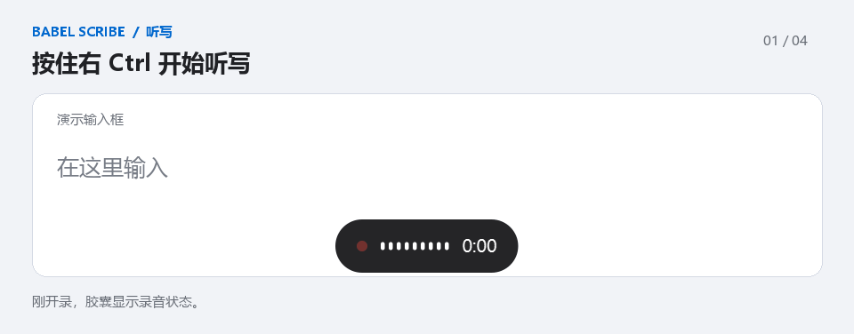
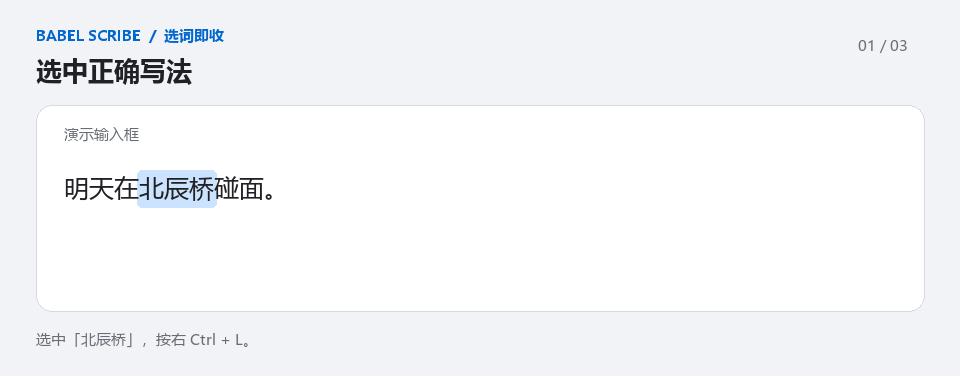
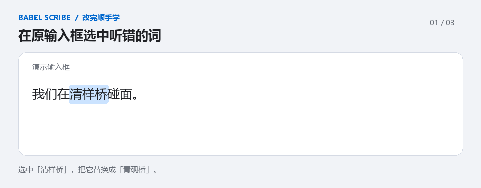
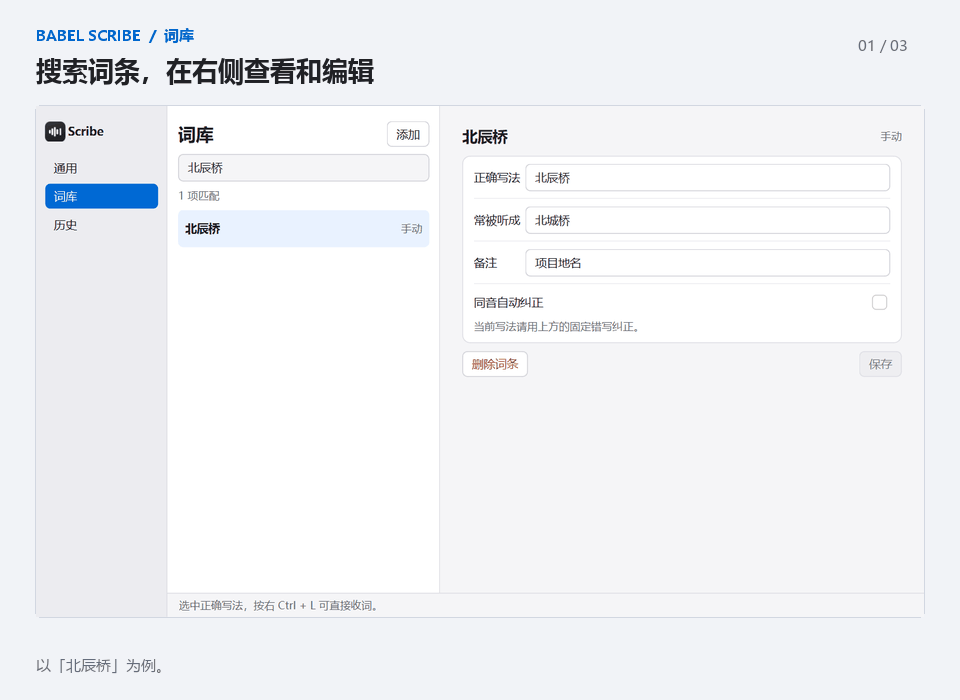
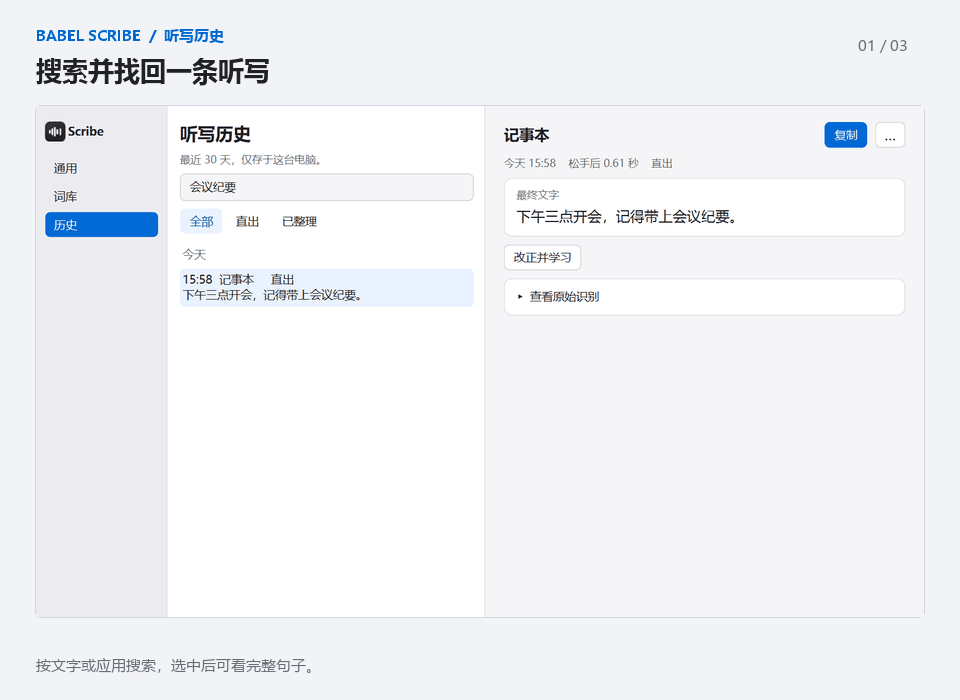

  

<h1 align="center">BABEL Scribe</h1>

<strong>按住右 Ctrl 说话，松手就把文字打到光标处。</strong> 
Windows 本机语音键盘，带个人词库和听写历史。

  <strong><a href="https://github.com/nelson-nie-work/babel-scribe-preview/releases/download/v0.1.0-alpha-cpu-preview/BABEL-Scribe-Setup-x64-0.1.0-alpha-candidate.exe">下载 Windows x64 安装包</a></strong>
  · <a href="https://github.com/nelson-nie-work/babel-scribe-preview/releases/tag/v0.1.0-alpha-cpu-preview">发行说明与校验值</a>
  · <a href="docs/USAGE.md#从源码启动">从源码运行</a>

CPU 预览版 · 安装包约 115 MB · 无需 NVIDIA 显卡

## 三步开始听写

1. 下载并运行安装程序。更新已有版本前，先从托盘退出 Scribe。
2. 从开始菜单打开 **BABEL Scribe Preview → BABEL Scribe**。首次启动会下载约 **240 MB** 的 SenseVoice 模型。
3. 托盘显示「就绪（单引擎）」后，把光标放进任意常用输入框，按住 **右 Ctrl** 说话，松手出字。

模型下载完成后，听写可以离线使用。预览安装包未签名，可在[发行页](https://github.com/nelson-nie-work/babel-scribe-preview/releases/tag/v0.1.0-alpha-cpu-preview)核对 SHA-256。

## 词库与历史

选中的正确写法可以用 **右 Ctrl + L** 收进词库。常被听错的人名、公司名和项目名，可以在词库里登记常见错写。漏粘贴或想找回上一句时，双击托盘图标打开「历史」。

<strong>选词即收</strong> · 选中正确写法，按右 Ctrl + L

<strong>改完顺手学</strong> · 改完错词，点「记住」收录正确写法

<strong>编辑词库</strong> · 搜索词条，在右侧改写法和备注

<strong>找回听写历史</strong> · 按文字或应用搜索，复制最终结果

## 本机识别与在线整理

| 用法 | 文字怎么处理 |
| --- | --- |
| **CPU 安装版** | SenseVoice 在本机识别。模型下载后可离线直出。 |
| **可选在线整理** | 配置服务后，可让 OpenAI 等模型整理文字。只在使用在线整理时发送转写文字和相关词条，录音留在本机。 |
| **源码版双引擎** | 配置 NVIDIA 后，可以加用 Whisper。独立的 NVIDIA 安装版尚未发布。 |

[快捷键、设置、已知问题与实测口径](docs/USAGE.md) · [提交问题](https://github.com/nelson-nie-work/babel-scribe-preview/issues) · [MIT 许可证](LICENSE) · [第三方许可](THIRD_PARTY_NOTICES.md)
