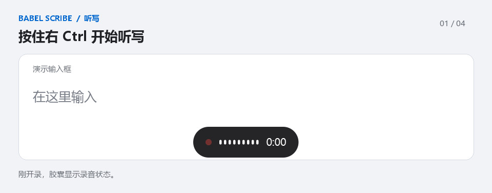
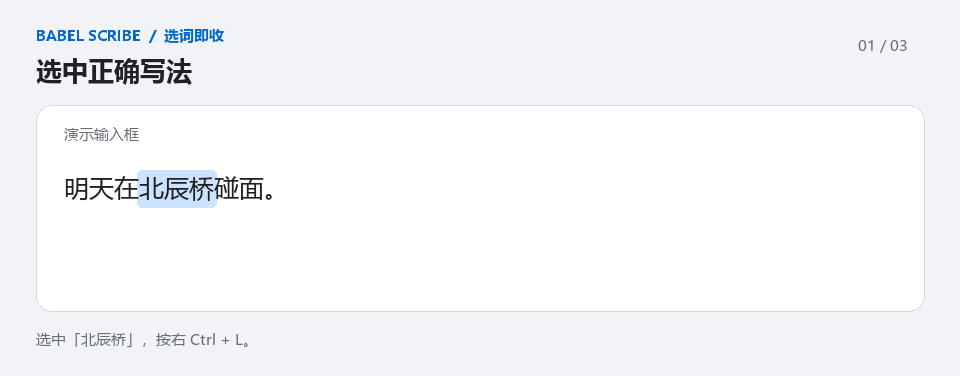
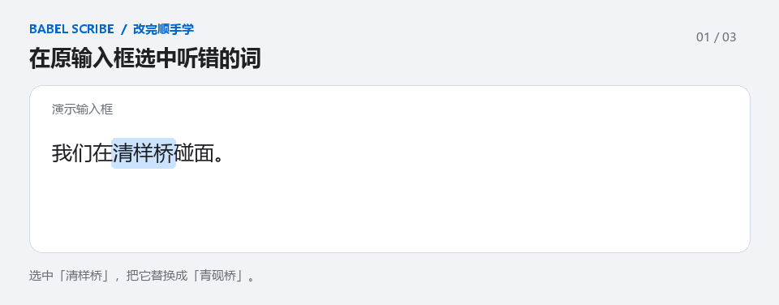
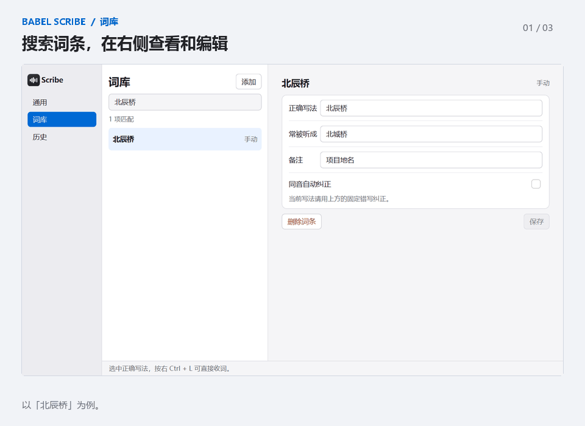
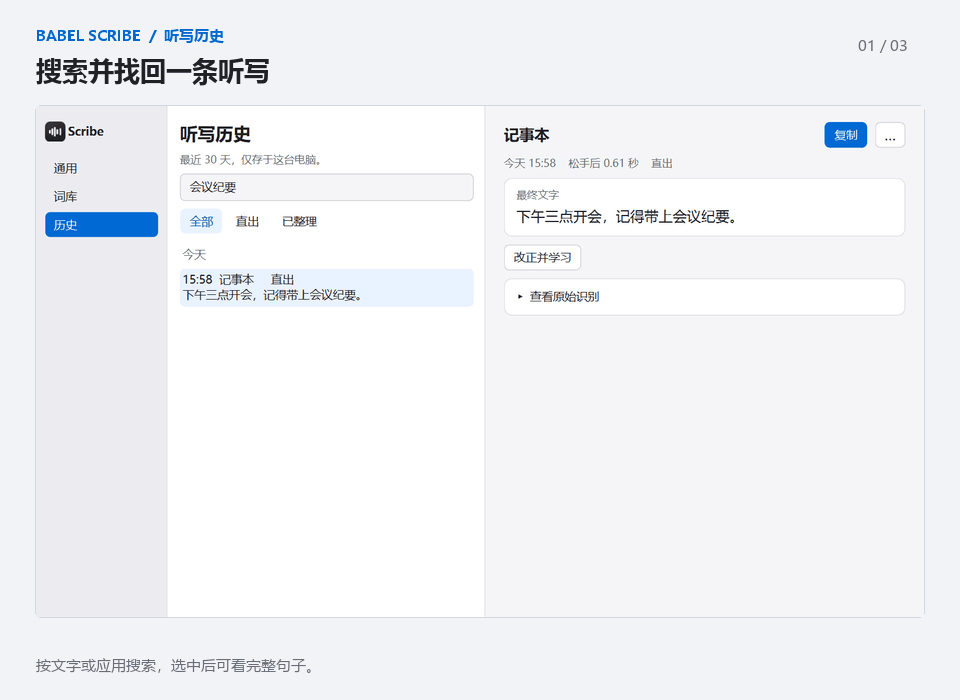

<p align="center">
  
</p>
<h1 align="center">BABEL Scribe</h1>

<p align="center"><strong>English</strong> · <a href="#简体中文">简体中文</a></p>

<p align="center"><strong>Hold Right Ctrl to speak. Release it to type at the cursor.</strong><br>
A Windows voice keyboard for people who think in Mandarin and type in English: dictate a prompt for Codex or Claude Code in Chinese, with file names, function names and product names in English, and Scribe types it where your cursor is.</p>
<p align="center">
  <strong><a href="https://github.com/nelson-nie-work/babel-scribe-preview/releases/download/v0.1.5-alpha-preview/BABEL-Scribe-Setup-x64-0.1.5-alpha.exe">Download for Windows x64</a></strong>
  · <a href="https://github.com/nelson-nie-work/babel-scribe-preview/releases/tag/v0.1.5-alpha-preview">Release notes and checksum</a>
  · <a href="#help-test-the-preview">Help test the preview</a>
</p>
<p align="center"><sub>Free and open source (MIT) · Runs on CPU, NVIDIA GPU optional · ~120 MB installer · The app UI is currently Simplified Chinese only</sub></p>



## Why Scribe

- **Mixed Mandarin and English in one breath.** SenseVoice recognises both languages in the same sentence, so you can say `把 pipeline.py 里的 retry 改成三次` without switching modes.
- **Runs on your PC.** Recognition happens on device and works offline after a one-time model download. Audio never leaves your computer.
- **Learns your words.** Correct a misheard name once and click **Remember**; Scribe fixes the same mistake next time. Add project names, people and jargon to a personal dictionary.
- **Fast enough to talk to an AI.** On our 26-sentence internal benchmark, text appears about **0.08 s** after you release the key. Optional online cleanup with your own API key cut the error rate from 17.5% to 11.7% at about 1 s. [Method and numbers](docs/USAGE.md#26-句内部基准).
- **Translate what you select (optional).** Turn on selection translation, select text in any app, and a small bar translates it to Chinese or English with your cleanup service. In an input field, press Enter to replace the selection. [How it works](docs/USAGE.md#划词翻译).
- **Nothing to lose.** Every dictation is kept in a local history for 30 days, so text that missed the input field can be copied back.

## Get started

1. Download and run the installer. To update, quit Scribe from the system tray first, then install over the existing folder.
2. Open **BABEL Scribe Preview → BABEL Scribe** from the Start menu. The first launch downloads the **~240 MB** SenseVoice model; hover over the tray icon to see progress. New installs start with Windows, which you can turn off in **通用 → 后台运行** (General → Background).
3. When the tray shows **就绪（单引擎）** (Ready, single engine), click into any text field, hold **Right Ctrl**, speak, and release.

| Action | Shortcut |
| --- | --- |
| Dictate | Hold Right Ctrl, release to type |
| Hands-free | Double-tap Right Ctrl to start, press once to stop |
| Cancel recording | Esc |
| Add selected word to the dictionary | Right Ctrl + L |
| Open settings, dictionary and history | Double-click the tray icon |

## Installation FAQ

<details>
<summary><strong>Windows says "Windows protected your PC"</strong></summary>

The preview installer is not code-signed yet, so Microsoft Defender SmartScreen warns about it. Check that the file's SHA-256 matches the [release page](https://github.com/nelson-nie-work/babel-scribe-preview/releases/tag/v0.1.5-alpha-preview), then click **More info → Run anyway**.

```powershell
Get-FileHash .\BABEL-Scribe-Setup-x64-0.1.5-alpha.exe -Algorithm SHA256
```

</details>

<details>
<summary><strong>The model download is stuck or fails</strong></summary>

Scribe downloads the model from Hugging Face and switches to the community-run [hf-mirror.com](https://hf-mirror.com) automatically when Hugging Face can't be reached. An interrupted download resumes where it stopped the next time you open Scribe. To choose the source yourself, run this once in PowerShell, quit Scribe from the tray, and open it again:

```powershell
[Environment]::SetEnvironmentVariable('HF_ENDPOINT', 'https://hf-mirror.com', 'User')
```

To go back to the default, run the same command with `$null` in place of the address. Hover over the tray icon to see download progress and the current source.

</details>

<details>
<summary><strong>Text comes out garbled when typed into Notepad</strong></summary>

Scribe normally pastes and then restores your clipboard. If the clipboard holds content it cannot safely restore, it types the text character by character instead, and a Chinese IME (such as Microsoft Pinyin) can intercept those keystrokes. Switch the IME to English mode before dictating, or copy the result from **历史** (History). The next release pastes in far more of these cases.

</details>

<details>
<summary><strong>Where is my data?</strong></summary>

Settings, history and your dictionary live in `%LOCALAPPDATA%\BABEL Scribe\User Data`; the model cache is in `%LOCALAPPDATA%\BABEL Scribe\Model Cache`. Uninstalling keeps both. Online cleanup is off until you add your own API key; when on, it sends the transcript and relevant dictionary entries, never audio. Details in the [usage guide](docs/USAGE.md#数据与在线整理).

</details>

## Personal dictionary and history

Select a correctly spelled term and press **Right Ctrl + L** to save it. When a name keeps being misheard, open **词库** (Dictionary) and add the exact misrecognition under **常被听成** (Often heard as), for example `Cloud Code` → `Claude Code`. Use **历史 → 查看原始识别** (History → View raw recognition) to see what was actually heard. [More dictionary tips](docs/USAGE.md#让个人词库纠正常见错写).

<details>
<summary><strong>Quick add</strong> · Select a term and press Right Ctrl + L</summary>



</details>

<details>
<summary><strong>Learn from an edit</strong> · Correct a word, then click 记住 (Remember)</summary>



</details>

<details>
<summary><strong>Edit dictionary entries</strong> · Search and edit spellings, common misrecognitions, and notes</summary>



</details>

<details>
<summary><strong>Recover past dictation</strong> · Search by text or app, then copy the final result</summary>



</details>

## Help test the preview

Scribe is an early preview, and real-world reports are the most useful thing you can give it. We especially want to hear:

- **Recognition misses:** what you said, what Scribe typed, and the raw recognition from History. Use a sample sentence instead of anything private.
- **Apps where text doesn't arrive** or arrives garbled, with the app name and your input method.
- **Long dictation:** does a 30–90 second passage come out complete?
- **Install problems:** SmartScreen, model download, antivirus or startup issues.

[Open an issue](https://github.com/nelson-nie-work/babel-scribe-preview/issues/new/choose) — the templates ask for the details we need. Want to work on the code? Read [CONTRIBUTING](CONTRIBUTING.md). Changes are listed in the [CHANGELOG](CHANGELOG.md).

## How it works

| Mode | What happens |
| --- | --- |
| **Single engine (default)** | SenseVoice-Small runs on your CPU through sherpa-onnx. Works offline after the model download. |
| **Optional online cleanup** | Add your own key for OpenAI, DeepSeek, GLM, OpenRouter, SiliconFlow, a local Ollama or any OpenAI-compatible service in settings, and a language model adds punctuation and fixes clear recognition errors. If its edit drops or changes content, Scribe keeps the local text. |
| **Optional dual engine** | With an NVIDIA GPU (4 GB VRAM or more), turn on **双引擎识别** (Dual engine) in settings. Scribe downloads NVIDIA's cuBLAS runtime and the Whisper model (about 2.2 GB), then runs Whisper Large V3 Turbo alongside SenseVoice and reconciles the two results. |

[Usage guide, settings and benchmarks (Chinese)](docs/USAGE.md) · [Run from source](docs/USAGE.md#从源码启动) · [MIT license](LICENSE) · [Third-party notices](THIRD_PARTY_NOTICES.md)

---

## 简体中文

[Back to English](#babel-scribe)

<p align="center"><strong>按住右 Ctrl 说话，松手就把文字打到光标处。</strong><br>
给习惯用中文思考、用英文写代码的人做的 Windows 语音键盘。给 Codex 或 Claude Code 写 prompt 时，用中文说清楚要改什么，文件名、函数名和产品名照常说英文，松手就出字。</p>
<p align="center">
  <strong><a href="https://github.com/nelson-nie-work/babel-scribe-preview/releases/download/v0.1.5-alpha-preview/BABEL-Scribe-Setup-x64-0.1.5-alpha.exe">下载 Windows x64 安装包</a></strong>
  · <a href="https://github.com/nelson-nie-work/babel-scribe-preview/releases/tag/v0.1.5-alpha-preview">发行说明与校验值</a>
  · <a href="#一起测试预览版">一起测试预览版</a>
</p>
<p align="center"><sub>免费开源（MIT）· CPU 即可运行，NVIDIA 显卡可选 · 安装包约 120 MB</sub></p>


## 为什么用 Scribe

- **中英混说一口气说完。** SenseVoice 在同一句里识别中文和英文，说「把 pipeline.py 里的 retry 改成三次」不用切换模式。
- **在你的电脑上识别。** 首次下载模型后可离线听写，录音不离开本机。
- **会记住你的词。** 听错的名字改一次、点「记住」，下次自动纠正。项目名、人名和行话可以加进个人词库。
- **够快，适合跟 AI 对话。** 在 26 句内部基准里，松手约 **0.08 秒**出字。配置自己的 API 密钥开启在线整理后，错字率从 17.5% 降到 11.7%，约 1 秒出字。[测法与数据](docs/USAGE.md#26-句内部基准)。
- **划词翻译（可选）。** 打开后在任意应用里选中文字，点悬浮条用你配置的整理服务译成中文或英文，在输入框里按回车直接替换。[用法](docs/USAGE.md#划词翻译)。
- **不怕丢字。** 每次听写都在本机历史保留 30 天，没打进输入框的文字可以找回复制。

## 三步开始听写

1. 下载并运行安装程序。更新时先从托盘退出 Scribe，再覆盖安装到原目录。
2. 从开始菜单打开 **BABEL Scribe Preview → BABEL Scribe**。首次启动会下载约 **240 MB** 的 SenseVoice 模型，鼠标停在托盘图标上可以看进度。新安装默认开机启动，可在「通用 → 后台运行」关闭。
3. 托盘显示「就绪（单引擎）」后，点进任意输入框，按住 **右 Ctrl** 说话，松手出字。

| 操作 | 用法 |
| --- | --- |
| 听写 | 按住右 Ctrl，松手出字 |
| 免手持 | 双击右 Ctrl 开始，再按一次结束 |
| 取消录音 | Esc |
| 收词 | 选中正确词，按右 Ctrl + L |
| 打开设置、词库和历史 | 双击托盘图标 |

## 安装常见问题

<details>
<summary><strong>Windows 提示「Windows 已保护你的电脑」</strong></summary>

预览安装包还没有代码签名，所以 Microsoft Defender SmartScreen 会拦一下。先核对文件的 SHA-256 与[发行页](https://github.com/nelson-nie-work/babel-scribe-preview/releases/tag/v0.1.5-alpha-preview)一致，再点「更多信息 → 仍要运行」。

```powershell
Get-FileHash .\BABEL-Scribe-Setup-x64-0.1.5-alpha.exe -Algorithm SHA256
```

</details>

<details>
<summary><strong>模型下载卡住或失败</strong></summary>

模型默认从 Hugging Face 下载，连不上时自动换到社区运营的镜像 [hf-mirror.com](https://hf-mirror.com)。下载中断后，下次打开 Scribe 会从断点继续。想自己指定下载源，在 PowerShell 运行一次下面的命令，从托盘退出 Scribe，再重新打开：

```powershell
[Environment]::SetEnvironmentVariable('HF_ENDPOINT', 'https://hf-mirror.com', 'User')
```

想改回默认，把地址换成 `$null` 再运行一次。鼠标停在托盘图标上可以看下载进度和当前来源。

</details>

<details>
<summary><strong>在记事本里出现乱码或成串句号</strong></summary>

Scribe 默认粘贴，粘贴后还原剪贴板。剪贴板内容无法安全还原时，会改成逐字输入，这时微软拼音等中文输入法可能截走按键。听写前把输入法切到英文，或者到「历史」里复制结果。下个版本会在绝大多数这类情况下改用粘贴。

</details>

<details>
<summary><strong>我的数据在哪里？</strong></summary>

设置、历史和词库在 `%LOCALAPPDATA%\BABEL Scribe\User Data`，模型缓存在 `%LOCALAPPDATA%\BABEL Scribe\Model Cache`，卸载时都会保留。在线整理要自己配置密钥才会开启；开启后只发送转写文字和相关词条，不发送录音。详见[使用指南](docs/USAGE.md#数据与在线整理)。

</details>

## 词库与历史

选中正确写法，按 **右 Ctrl + L** 收进词库。某个名字反复听错时，打开「词库」，在「常被听成」里登记实际错写，例如 `Cloud Code` → `Claude Code`。到「历史 → 查看原始识别」可以看到实际识别出的写法。[更多词库用法](docs/USAGE.md#让个人词库纠正常见错写)。

<details>
<summary><strong>选词即收</strong> · 选中正确写法，按右 Ctrl + L</summary>


</details>

<details>
<summary><strong>改完顺手学</strong> · 改完错词，点「记住」收录正确写法</summary>


</details>

<details>
<summary><strong>编辑词库</strong> · 搜索词条，在右侧改写法和备注</summary>


</details>

<details>
<summary><strong>找回听写历史</strong> · 按文字或应用搜索，复制最终结果</summary>


</details>

## 一起测试预览版

Scribe 还在早期预览阶段，真实使用中的反馈最有价值。我们特别想知道：

- **识别错误：** 你说了什么、Scribe 打出了什么，以及历史里的原始识别。请用示例句，不要贴私人内容。
- **文字没进去或出现乱码的应用：** 应用名称和你用的输入法。
- **长段听写：** 一口气说 30 到 90 秒，内容是否完整。
- **安装问题：** SmartScreen、模型下载、杀毒软件拦截或启动失败。

[提交问题](https://github.com/nelson-nie-work/babel-scribe-preview/issues/new/choose)，模板会列出需要的信息。想参与代码，请看 [CONTRIBUTING](CONTRIBUTING.md)。版本变化见 [CHANGELOG](CHANGELOG.md)。

## 工作方式

| 用法 | 文字怎么处理 |
| --- | --- |
| **单引擎（默认）** | SenseVoice-Small 通过 sherpa-onnx 在 CPU 上识别，下载模型后可离线使用。 |
| **可选在线整理** | 在设置里添加自己的 OpenAI、DeepSeek、智谱、OpenRouter、硅基流动、Ollama 本机或任何兼容 OpenAI 接口的服务密钥后，由大模型补标点、修正明确的识别错误。整理稿增删或改动内容时，保留本机识别稿。 |
| **可选双引擎** | 有 NVIDIA 显卡（显存 4 GB 以上）时，在设置里打开「双引擎识别」，程序下载 NVIDIA 的 cuBLAS 运行库和 Whisper 模型（约 2.2 GB），之后 Whisper Large V3 Turbo 与 SenseVoice 并行识别并互相校对。 |

[使用指南、设置与实测口径](docs/USAGE.md) · [从源码运行](docs/USAGE.md#从源码启动) · [MIT 许可证](LICENSE) · [第三方许可](THIRD_PARTY_NOTICES.md)
